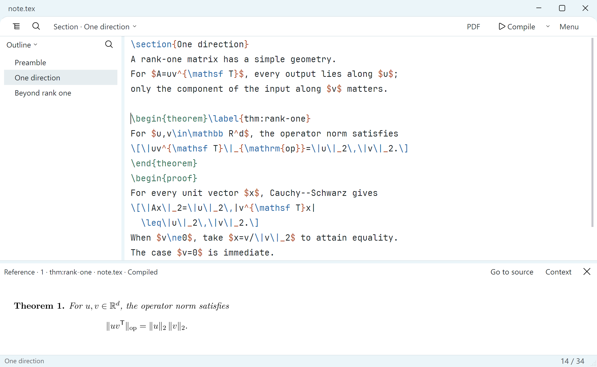
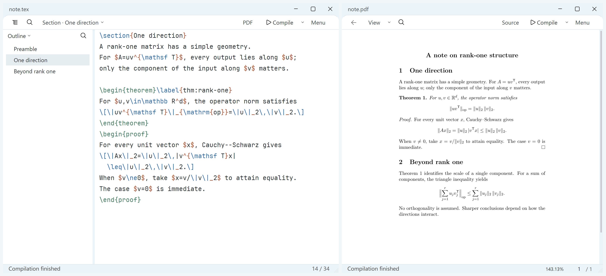
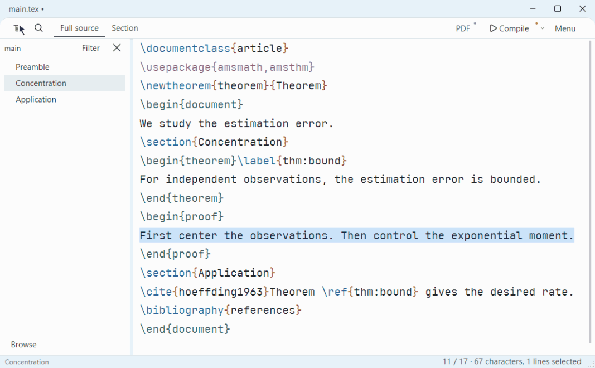
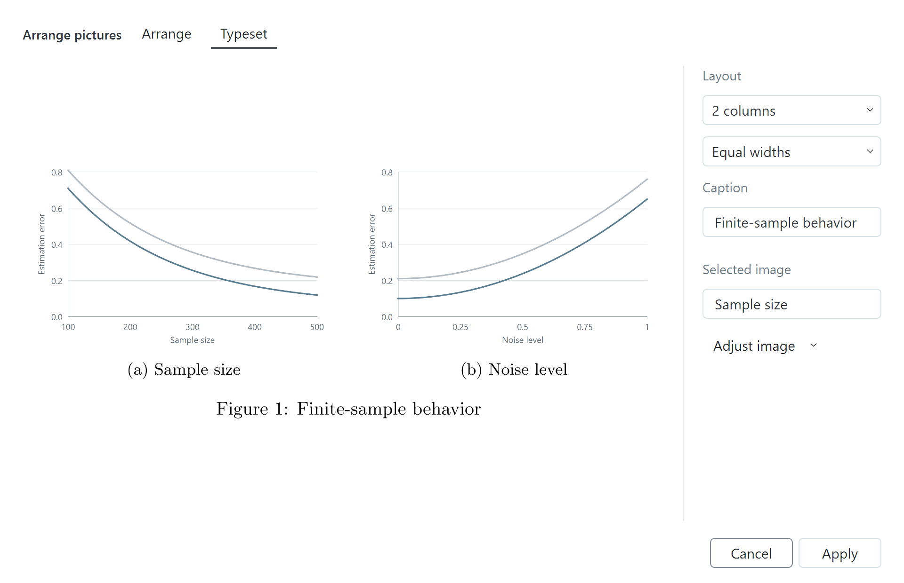
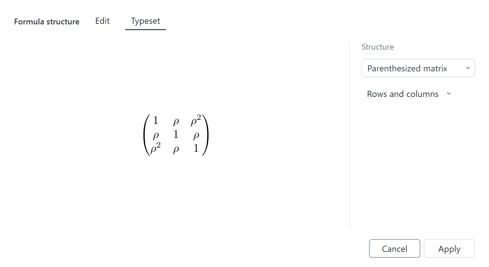
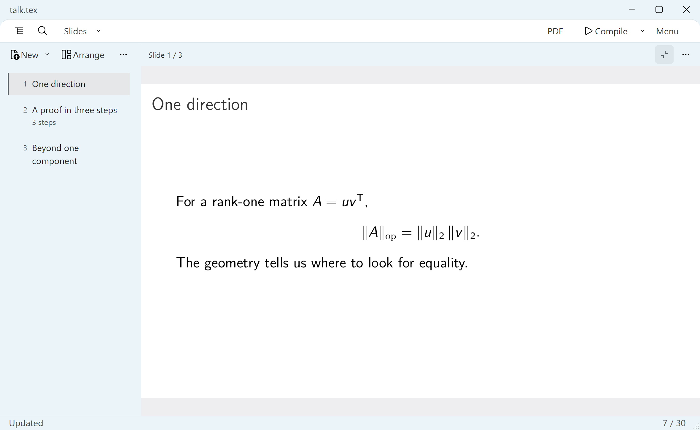
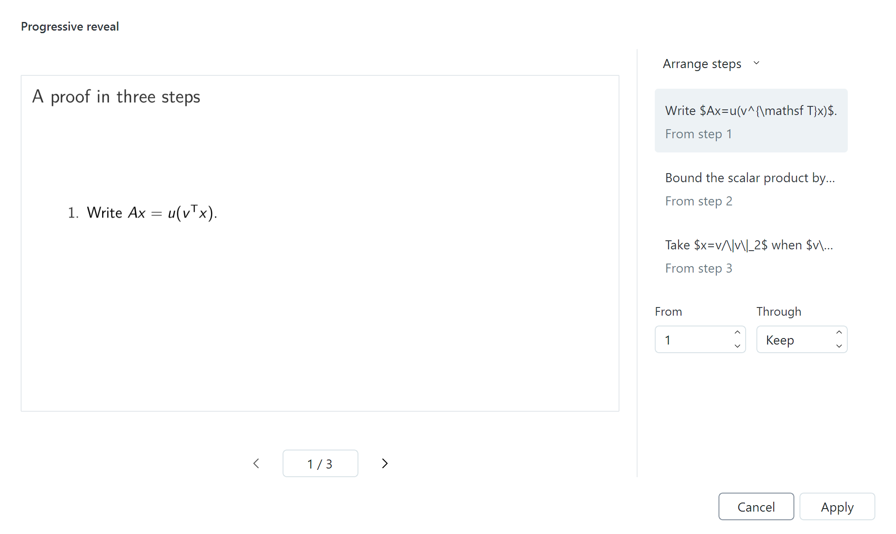

Write a note. Follow a proof. Shape a talk. Keep your attention on the idea, with ordinary LaTeX files underneath.

<strong><a href="https://github.com/novak382/TeXline/releases/download/v1.0.0/TeXline-1.0.0-Setup-x64.exe">Download for Windows</a></strong> &nbsp; · &nbsp; <a href="https://github.com/novak382/TeXline/releases/download/v1.0.0/TeXline-1.0.0-Portable-x64.zip">Portable ZIP</a> &nbsp; · &nbsp; <a href="#start-with-one-file">Get started</a> &nbsp; · &nbsp; <a href="README.zh-CN.md">简体中文</a>

Windows 10/11 x64 · Open source · English / 简体中文 / 繁體中文

Actual TeXline 1.0 · Native 2× capture · <a href="docs/media/reading.png">View full resolution</a> · <a href="examples/showcase">Open the sample</a>

TeXline is a desktop LaTeX editor for papers, notes and Beamer talks. A quiet writing surface meets tools for the moments that interrupt your thinking: finding a referenced result, trying another proof, arranging figures, or picking up where you stopped.

## Stay with the paragraph

Work on the full file or just the current section. Keep the document outline close, then enter focus mode when you want the writing surface to yourself. Your section, selection and reading position carry over.

Adjust the editor font and line spacing with a live preview. Turn on typewriter mode if you prefer the current line to stay at a comfortable height. Menus begin with the essentials; additional entries are yours to choose in settings.

See source and PDF side by side

## Follow the argument without losing your place

Pin a theorem, proof or equation beside your draft. Open its reference context to see what it cites and which passages refer to it, then follow those links and return to your writing position.

Bibliographies stay part of the same workflow: link a `.bib` file, search local entries, insert a citation, and reopen an existing citation to change its references, page details or citation form. Reference context follows explicit LaTeX links; it does not infer mathematical dependencies.

## Try another version. Keep the thought.

**Before a rewrite**, keep a named version of the selected passage. Compare its content with the current text, inspect the exact source, and recover part or all of it. Restoring a passage can be undone.

**At the end of a session**, save a named writing place: the section you were editing, cursor and selection, pinned reading, PDF position and relevant layout. Open it later to return to that context.

Watch a passage being saved, changed and restored

The bundled short demonstration uses an independent sample. [More about versions and writing places](docs/FEATURES.md#keep-alternatives-and-return-later).

## Shape the layout, keep the source

Use a focused visual editor when arranging content is easier than writing its markup. Preview the result, apply the change, and return to your document.

| Working on… | TeXline helps you… |
| :--- | :--- |
| **Several figures** | Arrange images, choose columns and sizing, and edit individual and shared captions. |
| **A formula structure** | Edit matrices, cases and aligned expressions, with a typeset preview. |
| **A table** | Edit cells and paste tab-separated data from a spreadsheet. |
| **An image** | Paste a clipboard image and confirm its import into the project. |
| **A slide reveal** | Set when supported items appear and inspect each step. |

Recognized existing content can be reopened. Cancel keeps the document unchanged; applying a supported edit is undoable. Custom macros and ambiguous structures remain available in the source editor.

See formula structure editing

## Give the talk room to breathe

Open a Beamer file to work slide by slide. Reorder frames, edit the current slide, and expand the preview while keeping the slide list in reach. Return to the source when you are ready to revise.

Add speaker notes, work with progressive reveals, or start from a reusable template. Your talk stays a Beamer project that can be opened in other LaTeX tools.

Watch slide navigation and preview expansion

See progressive reveal editing

## Your project, in your folders

Work with ordinary `.tex`, `.bib`, `.sty` and `.cls` files. Navigate a multi-file document, use main-file and engine detection, review external changes, and manage versions through the built-in Git workflow. Templates can be imported for reuse or kept directly in the project.

Editing and local compilation need no TeXline account or cloud service. A locally available folder synchronized by Dropbox, OneDrive or Google Drive can use the same local workflow. Git operations require Git; cloud-folder synchronization is handled by its own client.

[Explore the workflows and their entry points →](docs/FEATURES.md)

## Start with one file

1. **Install TeX.** Use [TeX Live](https://tug.org/texlive/) or [MiKTeX](https://miktex.org/); TeXline uses your local engine and packages.
2. **Get TeXline.** Run the [Windows installer](https://github.com/novak382/TeXline/releases/download/v1.0.0/TeXline-1.0.0-Setup-x64.exe), or extract the [portable ZIP](https://github.com/novak382/TeXline/releases/download/v1.0.0/TeXline-1.0.0-Portable-x64.zip) into a writable folder. Launch `TeXline.exe` there.
3. **Start writing.** Open a file, create a document from the start page, or copy the supplied `examples/first-session` folder to your writing directory. Choose **Compile** to see the PDF. Use SyncTeX to move between source and output.

The installer works per user and leaves file associations unchanged. The Windows package is currently unsigned. [Installation details](docs/INSTALL.md) · [Known limitations](docs/KNOWN-LIMITATIONS.md) · [1.0 release](https://github.com/novak382/TeXline/releases/tag/v1.0.0)

## Help make the next version better

[Report a problem](https://github.com/novak382/TeXline/issues) with a small shareable example, or [contribute](CONTRIBUTING.md). Tell us what you were trying to do and where the flow broke. Please remove private manuscript text and personal paths from reports.

### Built on TeXworks

TeXline is an independent derivative of [TeXworks](https://github.com/TeXworks/texworks). Original authors' notices and GPL-2.0-or-later grants are preserved; this combined Qt 6 distribution uses the GPLv3 option. TeXline additions are GPL-3.0-or-later. Assets and dependencies retain their own terms.

[License](LICENSE) · [Upstream license](COPYING) · [Third-party notices](THIRD-PARTY-NOTICES.md) · [Build from source](docs/BUILDING.md) · [Media provenance](docs/media/README.md)

Source and dependency reconstruction materials

The [1.0 release](https://github.com/novak382/TeXline/releases/tag/v1.0.0) includes the application source, checksums, the base RebuildKit and the 1.0.0 SDK update containing the modified Qt sources. **Use both SDK archives** to rebuild this version. See [build instructions](docs/BUILDING.md) and [source delivery](docs/LICENSING.md) for identities and verification boundaries.

