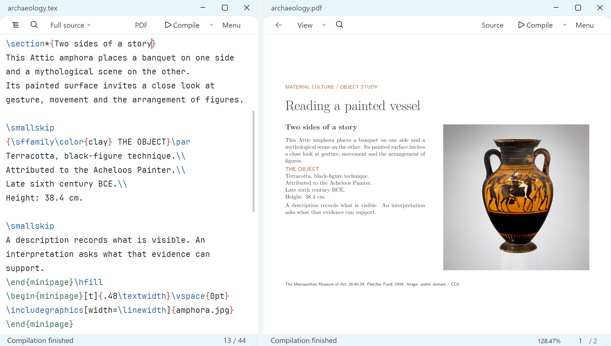
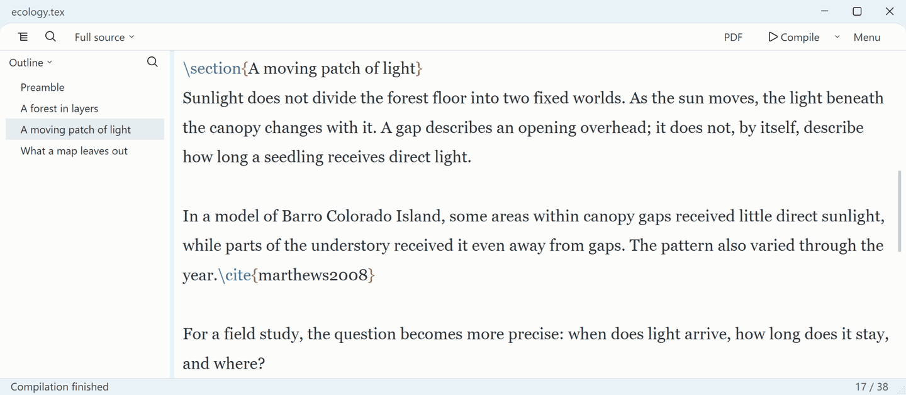
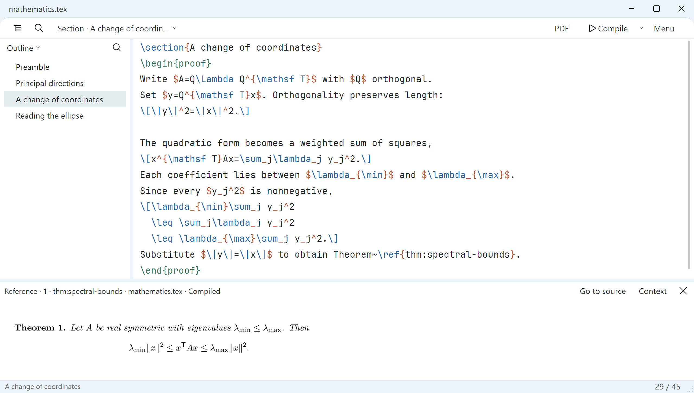
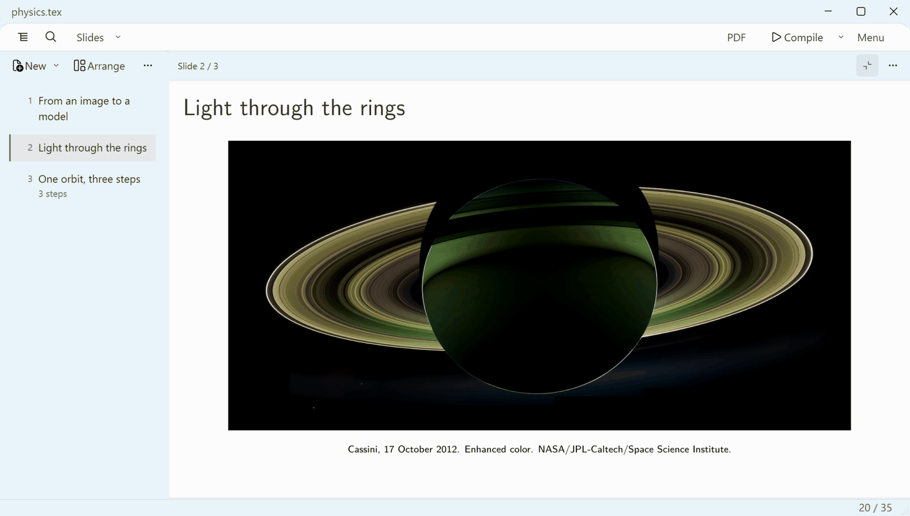

<h1 align="center">TeXline</h1>

LaTeX, with room to think.

A free, local editor for notes, papers and Beamer talks. Windows 10/11 x64 English · 简体中文 · 繁體中文

<a href="https://texline.dev/#download"><strong>Download</strong></a> &nbsp; · &nbsp; <a href="https://texline.dev/">Website</a> &nbsp; · &nbsp; <a href="README.zh-CN.md">简体中文</a>

Archaeology · From source to page.

TeXline gives your writing room while keeping ordinary LaTeX files underneath. Edit locally, compile with your own TeX installation, and move between source and PDF with SyncTeX. No account is needed.

## Just you. And the next sentence.

Work on one section or the whole file. Enter focus mode without losing your section, selection or reading position. Choose your font and line spacing; turn on typewriter scrolling if it suits you.

<a href="https://texline.dev/#focus"><picture><source media="(prefers-reduced-motion: reduce)" srcset="docs/media/showcase/ecology.png"></picture></a>

Ecology · Light beneath the canopy.

## Keep the idea in view.

Pin a theorem, proof or equation beside your draft. Follow its explicit references, see where it is cited, and return to where you were writing. Source and PDF stay connected through bidirectional SyncTeX.

Mathematics · A proof, with its reference in reach.

## Give your talk room to breathe.

Drag Beamer slides into order, edit the current frame and reveal an argument one step at a time. Expand the preview to read your slides while keeping the slide list in reach.

<a href="https://texline.dev/#visual"><picture><source media="(prefers-reduced-motion: reduce)" srcset="docs/media/showcase/physics.png"></picture></a>

Physics · From Saturn’s rings to orbital motion.

[Watch the demos](https://texline.dev/) · [Try the four sample projects](https://texline.dev/samples/showcase-samples.zip) · [Image credits & recording details](docs/media/README.md)

## Tools for the rest of the work

- Arrange multi-panel figures, edit table cells and shape matrices, cases or aligned equations with a preview. Reopen supported content to revise it; applying an edit is undoable.
- Link a `.bib` file, search your bibliography, insert a citation and edit its references or page details later.
- Keep a named version of a passage before rewriting. Compare it with the current text and restore what you need, with undo.
- Save a writing session and return to your section, cursor, selection, pinned reading and PDF position.
- Work across `.tex`, `.bib`, `.sty` and `.cls` files, reuse templates, review external changes and use the built-in Git workflow.

Menus start with the essentials and can be customized in settings. [Find each feature and its entry point](docs/FEATURES.md).

## Start with one file

1. Install [TeX Live](https://tug.org/texlive/) or [MiKTeX](https://miktex.org/). TeXline uses your local engines and packages.
2. Get the [Windows installer](https://texline.dev/downloads/v1.0.0/TeXline-1.0.0-Setup-x64.exe) or [portable ZIP](https://texline.dev/downloads/v1.0.0/TeXline-1.0.0-Portable-x64.zip), then open `TeXline.exe`.
3. Open a file or start from a template. Choose **Compile** to see the PDF.

The installer works per user and leaves file associations unchanged. The Windows package is currently unsigned. Git features require a separate Git installation.

[Installation](docs/INSTALL.md) · [First writing session](docs/FIRST-SESSION.md) · [Release & checksums](https://github.com/novak382/TeXline/releases/tag/v1.0.0) · [Known limitations](docs/KNOWN-LIMITATIONS.md)

## Feedback and contributing

[Open an issue](https://github.com/novak382/TeXline/issues) with what you were trying to do and a small example that reproduces the problem. Remove private text and personal paths before sharing. See [contributing](CONTRIBUTING.md) and [building from source](docs/BUILDING.md) for development.

## Built on TeXworks

TeXline is an independent derivative of [TeXworks](https://github.com/TeXworks/texworks). Original authors’ notices and GPL-2.0-or-later grants are preserved; this combined Qt 6 distribution uses the GPLv3 option. TeXline additions are GPL-3.0-or-later. Assets and dependencies retain their own terms.

[License](LICENSE) · [Upstream license](COPYING) · [Third-party notices](THIRD-PARTY-NOTICES.md) · [Source delivery](docs/LICENSING.md)

Rebuilding the 1.0 release

The [release assets](https://github.com/novak382/TeXline/releases/tag/v1.0.0) include the application source, checksums, the base RebuildKit and the 1.0.0 SDK update containing the modified Qt sources. Use **both SDK archives**. See [build instructions](docs/BUILDING.md) for reconstruction steps and verification boundaries.

